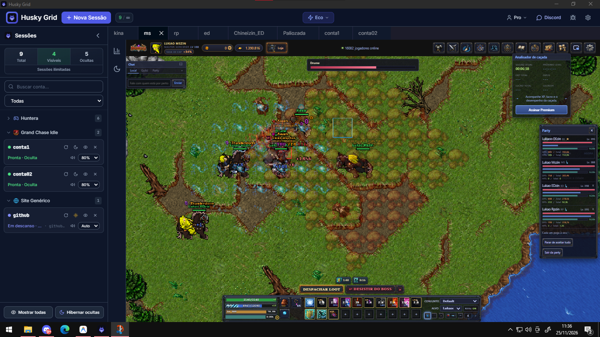
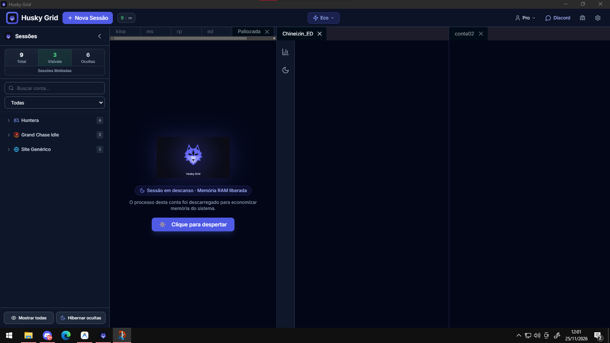
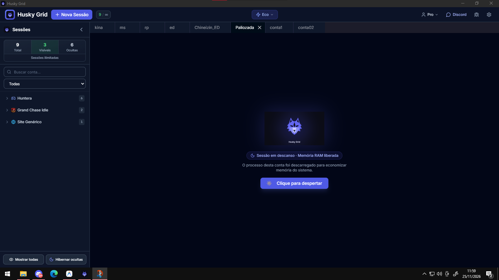

<div align="center">

# Husky Grid

**Multi-session browser grid manager with strict partition isolation and Eco Mode.**

[🇧🇷 Português](README.md) • [🇺🇸 English](README.en.md)

[](https://github.com/EdwilsonCruz/Husky-Grid-Releases/releases/latest)
[](https://github.com/EdwilsonCruz/Husky-Grid-Releases/releases)
[](https://github.com/EdwilsonCruz/Husky-Grid-Releases/releases/latest)
[](https://github.com/EdwilsonCruz/Husky-Grid-Releases/releases/latest)
[](#-license-and-source-code)

[Download Releases](https://github.com/EdwilsonCruz/Husky-Grid-Releases/releases/latest) •
[Showcase](#-visual-showcase) •
[Features](#-key-features) •
[Installation](#-installation) •
[Security](SECURITY.en.md) •
[Privacy](PRIVACY.en.md) •
[Report an Issue](https://github.com/EdwilsonCruz/Husky-Grid-Releases/issues)

<br /><br />



<sub>Overview of Husky Grid managing multiple concurrent isolated sessions with an active web game.</sub>

</div>

---

## About the Project

**Husky Grid** is a desktop application designed to run, organize, and monitor multiple browser accounts and sessions simultaneously within a single, flexible grid window. Engineered with strict Chromium partition isolation, it is tailored for idle web game players (such as **Huntera**) as well as professionals managing multiple concurrent accounts without cookie conflicts or session leaks.

This repository is dedicated exclusively to **official installer releases and changelogs**.

---

## Key Features

- **100% Isolated Sessions:** Each account operates in its own dedicated Chromium partition (`persist:husky-account-*`). Cookies, active logins, local storage, and cache never leak across panels.
- **Flexible Grid Layout:** Split screens horizontally and vertically, tab sessions together, and drag-and-drop freely via dockview. Layout states are automatically preserved across restarts.
- **Eco Mode:** Dynamically throttles CPU consumption and limits frame rates (FPS) on background or unfocused sessions to save system resources while maintaining active game connections.
- **Recipe Ecosystem:** Pre-configured profiles for supported idle web games alongside generic recipes that let you dock any custom web application URL.
- **Security & Privacy by Design (LGPD Compliant):** Operating in full alignment with data protection regulations (including Brazil's LGPD, Law No. 13,709/2018), your registered email is used strictly for licensing and will **never be reused, sold, or shared for marketing purposes**. The application enforces zero invasive telemetry, zero keystroke logging, and permanently blocks native OS permissions. Read more in our [Security](SECURITY.en.md) and [Privacy](PRIVACY.en.md) documents.
- **Free and Pro Tiers:** Get started for free with up to **4 concurrent sessions**, or subscribe to unlock expanded session limits and multi-device capabilities.

---

## Visual Showcase

| Multi-Session Grid Layout | Smart Memory Saver (Hibernation) |
| :---: | :---: |
|  |  |
| *Flexible column and tab management (dockview)* | *Automatic process unloading to conserve system RAM* |

---

## Installation

Go to the [**Latest Release**](https://github.com/EdwilsonCruz/Husky-Grid-Releases/releases/latest) page and download the package matching your operating system:

### Windows (x64)
1. Download `Husky-Grid-Setup-x.y.z.exe`.
2. Run the installer and follow the on-screen setup prompts.
3. **Windows SmartScreen Note:** As a newly released standalone application distributed through GitHub, Windows Defender SmartScreen may display an *"Unknown Publisher"* warning. Click **More info** → **Run anyway**.

### Linux (x64)

#### Option 1: AppImage (Universal for most Linux distributions)
1. Download `Husky-Grid-x.y.z.AppImage`.
2. Open a terminal, make the file executable, and run:
   ```bash
   chmod +x Husky-Grid-*.AppImage
   ./Husky-Grid-*.AppImage
   ```

#### Option 2: Debian / Ubuntu Package (.deb)
1. Download `husky-grid_x.y.z_amd64.deb`.
2. Install via terminal:
   ```bash
   sudo apt install ./husky-grid_*_amd64.deb
   # or: sudo dpkg -i husky-grid_*_amd64.deb
   ```

---

## Integrity Verification (SHA-256)

Every release includes an official `SHA256SUMS.txt` file. We strongly encourage verifying the cryptographic checksum of your downloaded binary before launching it.

### On Windows (PowerShell):
```powershell
Get-FileHash .\Husky-Grid-Setup-*.exe -Algorithm SHA256
```

### On Linux (Terminal):
```bash
sha256sum Husky-Grid-*.AppImage
# or:
sha256sum husky-grid_*_amd64.deb
```

Compare the resulting hash against the corresponding line in `SHA256SUMS.txt`. If they match, the binary has not been tampered with or corrupted during transit.

---

## Security & Privacy

Your security and account safety are core priorities:
- Review [**SECURITY.en.md**](SECURITY.en.md) for detailed explanations of our shell security policies, process isolation, and responsible vulnerability reporting.
- Review [**PRIVACY.en.md**](PRIVACY.en.md) to understand how local session storage and cloud license validation are strictly segmented.

---

## Support & Issue Reporting

For general questions, account inquiries, or bug reports:
- **Support Email:** `support@huskygrid.com.br`
- **Bug Reports & Feature Requests:** Open an [**Issue**](https://github.com/EdwilsonCruz/Husky-Grid-Releases/issues) including:
  1. **Application Version** (e.g., `v0.1.0`).
  2. **Operating System and Version** (e.g., Windows 11 x64, Ubuntu 24.04 LTS).
  3. **Step-by-step instructions** to reproduce the issue.
  4. **Log output or screenshots** where relevant.

> [!CAUTION]
> **Protect Sensitive Data:** Never post account passwords, cookies, authorization tokens, or payment details in public GitHub issues.

---

## License and Source Code

Copyright © 2026 **Edwilson Cruz**. All rights reserved.

Husky Grid is proprietary commercial software licensed under an End-User License Agreement (**EULA**). This repository hosts only pre-compiled distribution assets and release notes; the application source code is not published here.
