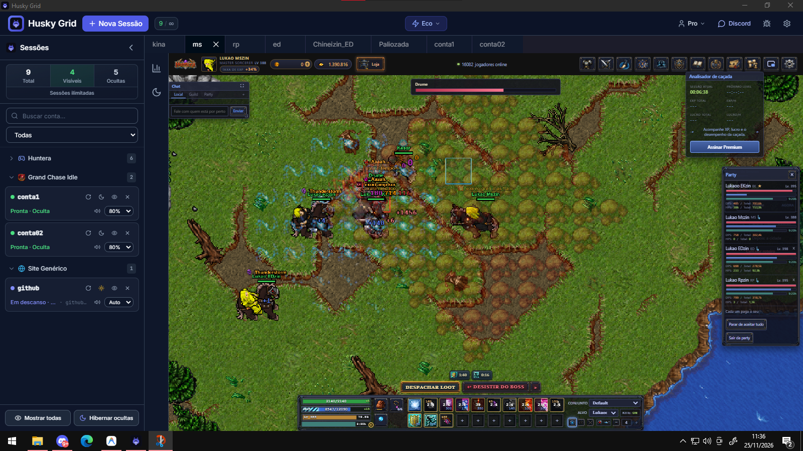
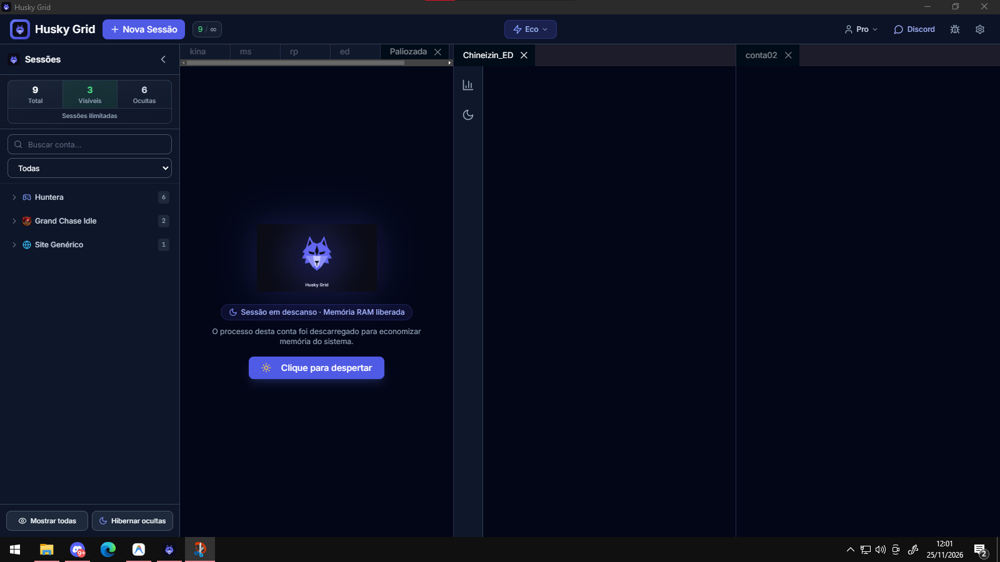
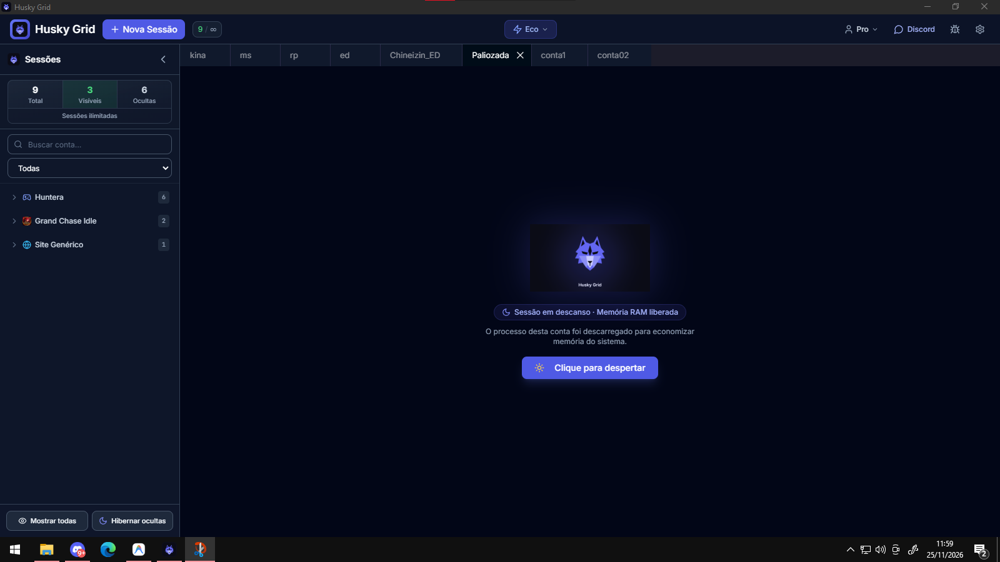

<div align="center">

# Husky Grid

**Gerenciador de múltiplas sessões em grade com isolamento completo e Eco Mode.**

[🇧🇷 Português](README.md) • [🇺🇸 English](README.en.md)

[](https://github.com/EdwilsonCruz/Husky-Grid-Releases/releases/latest)
[](https://github.com/EdwilsonCruz/Husky-Grid-Releases/releases)
[](https://github.com/EdwilsonCruz/Husky-Grid-Releases/releases/latest)
[](https://github.com/EdwilsonCruz/Husky-Grid-Releases/releases/latest)
[](#-licen%C3%A7a-e-c%C3%B3digo-fonte)

[Baixar Releases](https://github.com/EdwilsonCruz/Husky-Grid-Releases/releases/latest) •
[Demonstração](#-demonstra%C3%A7%C3%A3o-visual) •
[Recursos](#-principais-recursos) •
[Instalação](#-instala%C3%A7%C3%A3o) •
[Segurança](SECURITY.md) •
[Privacidade](PRIVACY.md) •
[Reportar Problema](https://github.com/EdwilsonCruz/Husky-Grid-Releases/issues)

<br /><br />



<sub>Visão geral do Husky Grid gerenciando múltiplas sessões simultâneas com isolamento Chromium e jogo ativo.</sub>

</div>

---

## Sobre o projeto

O **Husky Grid** é um aplicativo desktop projetado para abrir, organizar e acompanhar múltiplas contas e sessões de navegador simultaneamente em uma única janela dividida em grade. Construído com isolamento rigoroso por partição Chromium, ele é ideal para jogadores de jogos *idle* de navegador (como **Huntera**) e profissionais que precisam gerenciar múltiplos acessos simultâneos sem conflito de cookies ou contas.

Este repositório é dedicado exclusivamente à **distribuição de instaladores oficiais e notas de versão**.

---

## Principais recursos

- **Sessões 100% isoladas:** cada conta roda em partição Chromium própria (`persist:husky-account-*`). Cookies, sessões ativas e cache nunca vazam entre telas.
- **Grade flexível:** divida a tela horizontal e verticalmente, crie abas e reorganize tudo livremente via arrastar e soltar (dockview). O layout é salvo automaticamente.
- **Eco Mode:** reduz o consumo de CPU e estabiliza a taxa de quadros (FPS) nas sessões que não estão em foco, garantindo economia sem desconectar os jogos.
- **Catálogo de receitas:** perfis pré-configurados para jogos conhecidos e suporte a receitas genéricas para qualquer URL.
- **Privacidade e segurança por design (LGPD):** em conformidade com a LGPD (Lei nº 13.709/2018), seu e-mail e dados cadastrais são usados exclusivamente para a licença e **nunca serão comercializados, reutilizados ou compartilhados para fins de marketing**. O app opera com zero telemetria invasiva, sem captura de senhas e com permissões nativas bloqueadas. Leia mais em [Segurança](SECURITY.md) e [Privacidade](PRIVACY.md).
- **Planos Gratuito e Pro:** use gratuitamente com até **4 sessões simultâneas** ou assine planos pagos para suporte a mais telas e múltiplos dispositivos.

---

## Demonstração visual

### 🎬 Uso na Prática: Sessões de Navegador e Jogos (Vídeo)

Veja o Husky Grid em funcionamento gerenciando sessões simultâneas de navegador e jogos:

https://github.com/EdwilsonCruz/Husky-Grid-Releases/raw/main/docs/videos/usage-demo.mp4

> 💡 *Caso o player acima não carregue no seu navegador, você pode [assistir diretamente ao vídeo de uso aqui](docs/videos/usage-demo.mp4).*

### ⚙️ Tour pelas Configurações (Vídeo)

Confira uma visão rápida das opções de configuração e preferências disponíveis no Husky Grid:

https://github.com/EdwilsonCruz/Husky-Grid-Releases/raw/main/docs/videos/demo.mp4

> 💡 *Caso o player acima não carregue no seu navegador, você pode [assistir diretamente ao vídeo de configurações aqui](docs/videos/demo.mp4).*

<br />

| Grade Flexível em Painéis | Economia Inteligente de Memória (Hibernação) |
| :---: | :---: |
|  |  |
| *Divisão em colunas e abas flexíveis (dockview)* | *Descarregamento automático de processos para economizar RAM* |

---

## Instalação

Acesse a página de [**Última Versão (Latest Release)**](https://github.com/EdwilsonCruz/Husky-Grid-Releases/releases/latest) e baixe o arquivo correspondente ao seu sistema operacional:

### Windows (x64)
1. Baixe o instalador `Husky-Grid-Setup-x.y.z.exe`.
2. Execute o instalador e conclua a instalação.
3. **Aviso do Windows SmartScreen:** por se tratar de um software novo distribuído diretamente pelo GitHub, o Windows pode exibir o alerta *"O Windows protegeu o computador"*. Clique em **Mais informações** → **Executar assim mesmo**.

### Linux (x64)

#### Opção 1: AppImage (Universal para a maioria das distribuições)
1. Baixe o arquivo `Husky-Grid-x.y.z.AppImage`.
2. No terminal, dê permissão de execução e execute:
   ```bash
   chmod +x Husky-Grid-*.AppImage
   ./Husky-Grid-*.AppImage
   ```

#### Opção 2: Pacote Debian / Ubuntu (.deb)
1. Baixe o arquivo `husky-grid_x.y.z_amd64.deb`.
2. Instale via terminal:
   ```bash
   sudo apt install ./husky-grid_*_amd64.deb
   # ou: sudo dpkg -i husky-grid_*_amd64.deb
   ```

---

## Verificação de integridade (SHA-256)

Cada versão oficial acompanha o arquivo `SHA256SUMS.txt`. É recomendável verificar se o arquivo baixado não foi corrompido ou adulterado.

### No Windows (PowerShell):
```powershell
Get-FileHash .\Husky-Grid-Setup-*.exe -Algorithm SHA256
```

### No Linux (Terminal):
```bash
sha256sum Husky-Grid-*.AppImage
# ou:
sha256sum husky-grid_*_amd64.deb
```

Compare a sequência hexadecimal obtida com a linha correspondente dentro de `SHA256SUMS.txt`. Se forem idênticos, o arquivo é autêntico.

---

## Segurança e Privacidade

Sua segurança e a integridade das suas contas são prioridades fundamentais:
- Consulte [**SECURITY.md**](SECURITY.md) para conhecer a arquitetura de proteção do shell, o isolamento de processos e as instruções de divulgação responsável de vulnerabilidades.
- Consulte [**PRIVACY.md**](PRIVACY.md) para detalhes sobre dados armazenados localmente vs. dados de validação de licença.

---

## Suporte e reporte de problemas

Para dúvidas, assistência com sua conta ou relatos de problemas:
- **E-mail de suporte:** `support@huskygrid.com.br`
- **Reporte de bugs e melhorias:** abra uma [**Issue**](https://github.com/EdwilsonCruz/Husky-Grid-Releases/issues) informando:
  1. **Versão instalada** (ex.: `v0.1.0`).
  2. **Sistema operacional e versão** (ex.: Windows 11 x64, Ubuntu 24.04 x64).
  3. **Passos detalhados** para reproduzir a ocorrência.
  4. **Logs ou capturas de tela** (se aplicável).

> [!CAUTION]
> **Proteja seus dados:** nunca inclua senhas de contas, cookies, chaves de autenticação ou informações financeiras em issues públicas.

---

## Licença e código-fonte

Copyright © 2026 **Edwilson Cruz**. Todos os direitos reservados.

O Husky Grid é um software comercial sob licença proprietária (**EULA**). Este repositório armazena apenas binários compilados oficiais e notas de versão; o código-fonte do produto não é distribuído publicamente aqui.
